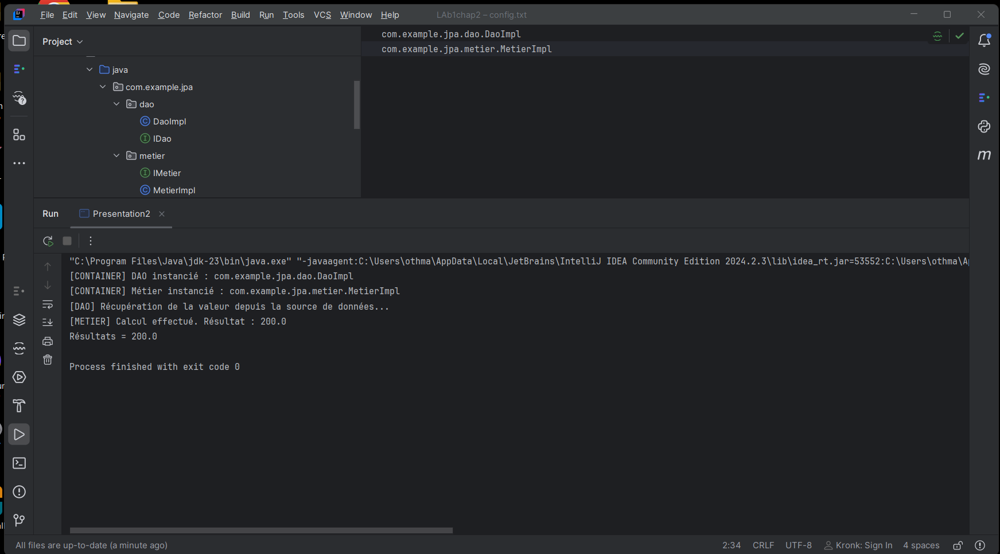

# TP Java – JPA

## Description
Ce projet permet de mettre en pratique les concepts de Java et JPA.

## Technologies utilisées
- Java 23
- IntelliJ IDEA
- Maven
- JPA

## Exécution du programme

La capture suivante présente le résultat de l'exécution dans IntelliJ IDEA.

  